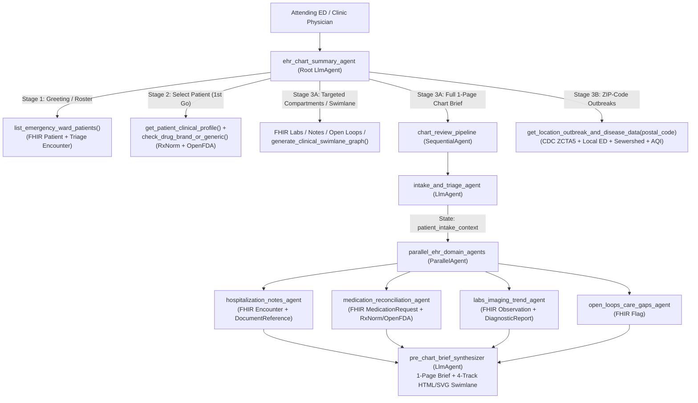

# `ehr_chart_summary_agent` — Emergency Ward Longitudinal FHIR Chart Summarizer, Medication Auditor & ZIP-Code Outbreak Intelligence Agent (Google ADK)

An interactive, multi-agent clinical decision-support system built with the **Google Agent Development Kit (`google-adk`)**, **Vertex AI (`gemini-3.8-flash`)**, and **Google Cloud Healthcare API (HL7 FHIR R4)**.

Designed for attending Emergency Department (ED) and clinic physicians, **`ehr_chart_summary_agent`** connects directly to a **GCP Cloud Healthcare FHIR R4 Store** (`Patient/$everything`), guides the physician through a **progressive, stage-by-stage conversation** (instead of overwhelming them with a single-turn data dump), audits medications via **NIH RxNorm** & **OpenFDA**, synthesizes **Interactive 4-Track Clinical Swimlane Graphs** & **1-Page Pre-Chart Briefs**, and correlates findings with **strictly 5-digit ZIP-code-level outbreak & disease surveillance**.

---

## Key Capabilities

1. **Progressive Stage-by-Stage Clinical Workflow**:
   - **Stage 1 (Greeting & Ward Roster)**: Introduces agent capabilities and pulls the live Emergency Ward patient roster (`pat-001` – `pat-007`) from FHIR with chief complaints and residential ZIP codes.
   - **Stage 2 (Patient & Medication Audit — 1st Go)**: Retrieves the patient's FHIR triage vitals, intake note, active/past conditions, and allergies, alongside longitudinal **Medication Reconciliation** (dose changes, held medications with restart thresholds, real-world adherence barriers), **Original Drug Name (Generic) vs. Brand Name** classification (**NIH NLM RxNorm API**), and **Clinical Uses, Boxed Warnings & Known Adverse Effects** (**OpenFDA Drug Label & FAERS APIs**).
   - **Stage 3A (Longitudinal Chart Compartments, 4-Track Swimlane & 1-Page Brief)**: On request, retrieves multi-date lab trajectories (`Baseline -> Peak -> Latest`), diagnostic imaging (`CT`, `TTE Echo`, `CXR`), hospitalization/consult notes, unresolved open clinical loops (`Flag`), or delegates to `chart_review_pipeline` (`SequentialAgent` + `ParallelAgent`) to synthesize a full **1-Page Physician Chart Brief + Interactive 4-Track Clinical Swimlane Graph**.
   - **Stage 3B (Hyperlocal Patient 5-Digit ZIP-Code Outbreak Surveillance)**: Queries **strictly the patient's 5-digit ZIP code (`postal_code`)** — never high-level statewide or national summaries — combining **CDC PLACES ZCTA5 (`qnzd-25i4`)**, **CDC NSSP Local Hospital ED Trajectories (`rdmq-nq56`)**, **CDC NWSS Local Sewershed Wastewater Pathogens**, and **Open-Meteo Hyperlocal Air Quality**.
   - **Next-Stage Guidance & Verifiable Citations**: Every turn ends with actionable **Suggested Next Steps** and cites exact FHIR resource IDs (no private FHIR links) plus clickable URLs for all external public health and drug APIs.

---

## Multi-Agent Architecture



---

## Repository Structure

```text
MedicalChartAgent/
├── README.md
├── requirements.txt
├── run_demo.py                                   # CLI runner (live ADK + --offline deterministic trace)
├── outputs/                                      # Generated Interactive 4-Track HTML/SVG Swimlane Viewers
│   └── clinical_swimlane_pat-005.html
└── ehr_chart_summary_agent/                      # Google ADK Agent Package
    ├── __init__.py
    ├── .env.example                              # Template environment variables
    ├── agent.py                                  # Root agent (`ehr_chart_summary_agent`)
    ├── clinical_tools.py                         # FHIR profile, RxNorm/OpenFDA & ZIP-code outbreak tools
    ├── ehr_chart_tools.py                        # FHIR longitudinal EHR compartment & swimlane tools
    ├── fhir_cohort_data.py                       # Canonical HL7 FHIR R4 builder for `pat-001`..`pat-007`
    ├── seed_fhir_store.py                        # Creates & populates GCP Cloud Healthcare FHIR R4 store
    ├── server.py                                 # GCP FHIR HTTP helpers & FastMCP tool server
    ├── swimlane_graph.py                         # Dynamic 4-Track Mermaid, Matrix & XSS-safe HTML/SVG builder
    ├── workflow.py                               # ADK Graph Workflow definition
    └── sub_agents/
        ├── chart_summarizer_pipeline/            # Sequential + Parallel 1-Page Chart Brief pipeline
        ├── drug_brand_checker/                   # NIH RxNorm + OpenFDA specialist sub-agent
        ├── get_adverse_effects/                  # FAERS adverse event sub-agent
        ├── get_medication_details/               # FHIR medication lookup sub-agent
        ├── outbreak_surveillance/                # Hyperlocal 5-digit ZIP-code surveillance sub-agent
        └── patient_fhir_profile/                 # FHIR $everything clinical profile sub-agent
```

---

## 1. Prerequisites & Installation

- **Python**: `3.11+` (`3.12` – `3.14` supported)
- **Google Cloud SDK (`gcloud`)**: Installed for Vertex AI & Cloud Healthcare FHIR API authentication

```bash
# 1. Clone the repository
git clone https://github.com/Sivaram0606/MedicalChartAgent.git
cd MedicalChartAgent

# 2. Create and activate a virtual environment
python3 -m venv .venv
source .venv/bin/activate

# 3. Install dependencies
pip install -r requirements.txt
```

---

## 2. Environment Configuration (`.env`)

Copy `.env.example` to `ehr_chart_summary_agent/.env` and set your GCP Project ID:

```bash
cp ehr_chart_summary_agent/.env.example ehr_chart_summary_agent/.env
```

Edit `ehr_chart_summary_agent/.env`:

```env
GOOGLE_GENAI_USE_VERTEXAI=TRUE
GOOGLE_CLOUD_PROJECT=your-gcp-project-id
GOOGLE_CLOUD_LOCATION=global
MODEL_NAME=gemini-3.8-flash

FHIR_DATASET_LOCATION=asia-east1
FHIR_DATASET_ID=test
FHIR_STORE_ID=synthe_data
```

> **Note on `GOOGLE_CLOUD_LOCATION=global`**: `gemini-3.8-flash` on Vertex AI uses the `global` endpoint (`locations/global/publishers/google/models/gemini-3.8-flash`).

---

## 3. How to Create & Populate the GCP Cloud Healthcare FHIR R4 Store

The included [`seed_fhir_store.py`](ehr_chart_summary_agent/seed_fhir_store.py) script automatically creates the **Cloud Healthcare Dataset**, creates the **FHIR R4 Store** (if they do not already exist), and upserts all **7 longitudinal patient cohorts (`pat-001` – `pat-007`)** across 9 HL7 FHIR R4 resource types (`Patient`, `Encounter`, `DocumentReference`, `Condition`, `AllergyIntolerance`, `MedicationRequest`, `Observation`, `DiagnosticReport`, and `Flag`).

### Step 3.1 — Authenticate & Enable Required GCP APIs

```bash
# Authenticate your user credentials for Application Default Credentials (ADC)
gcloud auth login
gcloud auth application-default login

# Set your active GCP project
export PROJECT_ID="your-gcp-project-id"
gcloud config set project "$PROJECT_ID"

# Enable the Cloud Healthcare API and Vertex AI API
gcloud services enable healthcare.googleapis.com aiplatform.googleapis.com --project="$PROJECT_ID"
```

### Step 3.2 — Ensure Required IAM Roles (if not Project Owner/Editor)

Your authenticated principal needs:
- `roles/healthcare.datasetAdmin` and `roles/healthcare.fhirResourceEditor` (to create the dataset/store and read/write FHIR resources)
- `roles/aiplatform.user` (to invoke `gemini-3.8-flash` on Vertex AI)

### Step 3.3 — Run the FHIR Store Seeder

```bash
python -m ehr_chart_summary_agent.seed_fhir_store \
  --project "$PROJECT_ID" \
  --location asia-east1 \
  --dataset test \
  --fhir-store synthe_data
```

*(If you already configured `ehr_chart_summary_agent/.env`, you can simply run `python -m ehr_chart_summary_agent.seed_fhir_store` with no flags.)*

### Step 3.4 — Verify Seeded FHIR Resources (Optional)

```bash
curl -s -H "Authorization: Bearer $(gcloud auth application-default print-access-token)" \
  "https://healthcare.googleapis.com/v1/projects/${PROJECT_ID}/locations/asia-east1/datasets/test/fhirStores/synthe_data/fhir/Patient" | head -n 40
```

> **Automatic Local FHIR R4 Fallback**: If GCP credentials are not configured or offline, all tools automatically fall back to identical in-memory HL7 FHIR R4 `Patient/$everything` bundles built by [`fhir_cohort_data.py`](ehr_chart_summary_agent/fhir_cohort_data.py) so local testing and demos always work out of the box.

---

## 4. Commands to Start & Run the ADK App

Run all commands below from the **repository root (`MedicalChartAgent/`)** with your virtual environment activated (`source .venv/bin/activate`):

### Option A — Launch the Interactive ADK Web UI (Recommended)

```bash
adk web
```

1. Open **`http://127.0.0.1:8000`** in your browser.
2. In the top-left agent selector dropdown, choose **`ehr_chart_summary_agent`**.
3. Start chatting with **`Hi`** to view capabilities and the 7-patient Emergency Ward roster!

*(To run on a custom port, e.g., `8085`: `adk web --host 127.0.0.1 --port 8085`)*

### Option B — Launch Interactive Terminal Chat (`adk run`)

```bash
adk run ehr_chart_summary_agent
```

### Option C — Launch ADK FastAPI Backend Server (`adk api_server`)

```bash
adk api_server --host 127.0.0.1 --port 8000
```

### Option D — Run the CLI Demo Script (`run_demo.py`)

```bash
# List all 7 Emergency Ward patients from FHIR
python run_demo.py --list

# Run live multi-agent 1-Page Chart Brief + 4-Track Swimlane via Vertex AI
python run_demo.py --patient pat-005

# Run deterministic local FHIR + RxNorm/OpenFDA + ZIP-Outbreak trace (no LLM key needed)
python run_demo.py --patient pat-005 --offline
```

### Option E — Run the Standalone MCP Tool Server (Optional)

```bash
python -m ehr_chart_summary_agent.server
```

---

## 5. Seeded Emergency Ward Patient Cohort (`pat-001` – `pat-007`)

| Patient ID | Patient Name | Location & ZIP | Chief Complaint Today | Key Clinical, Medication & Longitudinal Insights in FHIR |
| :--- | :--- | :--- | :--- | :--- |
| **`pat-001`** | **Alex Jordan Conn** (48M) | Boston, MA `02118` | Acute shortness of breath, wheezing & 3-day dry cough | • **ACEi Cough / Asthma Flare**: Lisinopril doubled to 10mg on 10/08 (`PEF 54%`, `Eos 520`).<br>• **Duplicate Active Ingredient**: Taking OTC brand **Tylenol** + leftover generic **Acetaminophen** (`ALT 22 -> 58 U/L`).<br>• **High-Criticality Allergy**: Sulfonamide antibiotics. |
| **`pat-002`** | **Maria Elena Reynolds** (62F) | Portland, OR `97205` | Proximal thigh weakness, dark urine & dizziness | • **CYP3A4 Statin Rhabdomyolysis**: Outside Urgent Care prescribed Clarithromycin without holding brand **Lipitor** (`CK 110 -> 4,850 U/L`).<br>• **Myoglobinuric AKI**: `Cr 0.85 -> 1.92` — requires immediate hold of both **Lipitor** and generic **Metformin ER**. |
| **`pat-003`** | **David Raj Patel** (41M) | San Francisco, CA `94108` | Severe epigastric pain, melena & orthostasis (`BP 98/62`) | • **NSAID Upper GI Bleed**: Self-escalated brand **Advil** to `2,400 mg/day` after previously stopping **Prilosec**.<br>• **Critical Lab Drop**: `Hemoglobin 14.6 -> 8.4 g/dL`, `BUN 46 mg/dL`. |
| **`pat-004`** | **Evelyn Grace Carter** (70F) | Austin, TX `78701` | Persistent 45-min epistaxis, bruising & AFib (`HR 112`) | • **Warfarin Toxicity**: Missed 2 Anticoagulation Clinic visits + started OTC cranberry/garlic supplements (`INR 2.4 -> 6.4`).<br>• **Transition Candidate**: Hold brand **Coumadin**, give Vitamin K, transition to DOAC. |
| **`pat-005`** *(alias `PAT-1001`)* | **Arthur Pendelton** (68M) | Chicago, IL `60611` | Worsening dyspnea on exertion & `+7.5 lb` ankle edema | • **Adherence & PA Barriers**: Self-cut **Lasix** `40mg -> 20mg`; never started **Jardiance** (`$180` Prior Auth block); `NT-proBNP 920 -> 1,850`.<br>• **Renal Recovery Unlocks Held GDMT**: **Lisinopril** & **Metformin** held for hospital AKI (`Cr 2.30`), now `Cr 1.50` (`eGFR 48`) — eligible for Entresto & Metformin.<br>• **Dropped Nodule Follow-Up**: Unordered 6-month CT for 7mm RUL lung nodule. |
| **`pat-006`** *(alias `PAT-1002`)* | **Elena Rostova** (54F) | Seattle, WA `98104` | Severe fatigue, nausea & abnormal labs | • **Methotrexate Hepatotoxicity**: Dose increase `15 -> 20mg/wk` spiked `ALT 92 / AST 78 U/L`.<br>• **Chelation Malabsorption**: Taking morning **Ferrous Sulfate** simultaneously with **Synthroid**, spiking `TSH 2.4 -> 6.8`.<br>• **Stalled Biologic**: Indeterminate QuantiFERON-TB while on Prednisone taper stalled Humira. |
| **`pat-007`** *(alias `PAT-1003`)* | **Marcus Vance** (42M) | Denver, CO `80203` | Bilateral calf cramps, weakness & `BP 168/102` post-ER | • **Critical Drug-Lab Alert**: ER started potassium-wasting **Chlorthalidone 25mg** despite `K+ 3.2 mEq/L`.<br>• **Unreviewed Send-Out Lab**: August `Aldosterone-to-Renin Ratio (ARR = 95)` confirms **Primary Hyperaldosteronism (Conn's Syndrome)**. |

---

## 6. Sample Questions & Multi-Turn Walkthrough

### Flow 1 — Progressive Stage-by-Stage Emergency Ward Consultation (Recommended)

**Turn 1 — Greeting & Emergency Ward Roster**
```text
Hi
```
*(Agent introduces its 5 capabilities, queries FHIR for `pat-001` – `pat-007`, displays the Emergency Ward patient table with Chief Complaints and ZIP codes, and suggests selecting a patient.)*

**Turn 2 — Select a Patient (1st Go: Triage + Medication Brand/Generic, Adherence & Adverse Effects)**
```text
Select pat-005 (Arthur Pendelton)
```
*(Agent presents Arthur's triage vitals, active conditions, allergies, active vs. held medications, Prior Auth/self-titration adherence gaps, RxNorm **ORIGINAL DRUG NAME vs. BRAND NAME** verification, and OpenFDA uses/adverse effects — then suggests next stages such as checking Longitudinal Labs/Open Loops, 4-Track Swimlane, or ZIP-Code Outbreaks.)*

**Turn 3 — Longitudinal Labs, Hospitalizations, Open Loops & 4-Track Swimlane Graph**
```text
Show his longitudinal lab trends, open clinical loops, and generate the 4-track clinical swimlane graph
```
*(Agent retrieves multi-date `Cr`, `eGFR`, `NT-proBNP`, `K+`, and `HbA1c` trajectories, `CT Chest` / `TTE` findings, open loops `OPEN-101`–`OPEN-104`, and renders the synchronized 4-Track Mermaid + Markdown Swimlane + saves `outputs/clinical_swimlane_pat-005.html`.)*

**Turn 4 — Hyperlocal Patient ZIP-Code Outbreak & Disease Surveillance**
```text
Check for any active outbreaks and persistent diseases in his zip code
```
*(Agent queries strictly ZIP code `60611` via CDC PLACES ZCTA5, local hospital ED trajectories, local sewershed pathogen detections, and ZIP air quality, correlating respiratory virus trends and air quality with his HFrEF dyspnea.)*

---

### Additional Copy-Paste Sample Queries

- **Full 1-Page Pre-Chart Brief via Multi-Agent Pipeline (`SequentialAgent` + `ParallelAgent`)**:
  ```text
  Generate a complete 1-page physician chart brief for pat-007 (Marcus Vance)
  ```
- **Drug-Induced Rhabdomyolysis & Brand/Generic Audit**:
  ```text
  Review pat-002 Maria Elena Reynolds — check her patient profile, medications (whether drug or brand name), and adverse effects
  ```
- **Methotrexate Hepatotoxicity + Thyroid Malabsorption Case**:
  ```text
  Select pat-006 Elena Rostova and review her medications, adherence issues, and longitudinal lab trends
  ```
- **Asthma + Duplicate Brand/Generic Acetaminophen + Boston `02118` ZIP Outbreaks**:
  ```text
  Select pat-001 Alex Jordan Conn, then check outbreaks in his zip code 02118
  ```
- **Bedside Name-Mismatch Safety Verification**:
  ```text
  Patient ID: pat-001, Name: John Smith. Presenting with wheezing and cough.
  ```

---

## 7. Open-Source Clinical & Public Health APIs Used

| Domain | API / Data Source | Granularity & Purpose |
| :--- | :--- | :--- |
| **Longitudinal EHR** | **Google Cloud Healthcare FHIR R4 (`Patient/$everything`)** | Demographics, Triage, Encounters, Notes, Meds, Labs, Imaging, Open Loops *(cited by FHIR Resource ID)* |
| **Drug Nomenclature** | **NIH NLM RxNorm REST API** (`rxnav.nlm.nih.gov`) | Verifies **Original Drug Name (Generic)** (`IN`/`SCD`) vs. **Brand Name** (`BN`/`SBD`) & active ingredients |
| **Drug Uses & Side Effects** | **OpenFDA Drug Label & FAERS APIs** (`api.fda.gov/drug/`) | Official SPL indications, pharmacologic class, boxed warnings, contraindications & top FAERS adverse events |
| **ZIP Persistent Diseases** | **CDC PLACES ZCTA5 API** (`data.cdc.gov/resource/qnzd-25i4.json`) | Exact **5-digit ZIP code** population & chronic/endemic disease prevalence |
| **Local ED Outbreaks** | **CDC NSSP Emergency Dept Trajectories** (`data.cdc.gov/resource/rdmq-nq56.json`) | Weekly local hospital ED visit % & trends (`Increasing`/`Decreasing`/`No Change`) for Flu, COVID-19 & RSV serving the ZIP code |
| **Local Wastewater Pathogens** | **CDC NWSS Wastewater Surveillance** (`ymmh-divb`, `j9g8-acpt`, `45cq-cw4i`, `akvg-8vrb`, `xpxn-rzgz`) | Real-time PCR viral concentrations & surges (Influenza A, SARS-CoV-2, RSV, Measles, Mpox) in the local sewershed serving the ZIP code |
| **ZIP Air Quality** | **Open-Meteo Air Quality API** (`air-quality-api.open-meteo.com`) | Hyperlocal US AQI, `PM2.5`, `PM10`, `Ozone` & `NO2` at exact ZIP coordinates |
