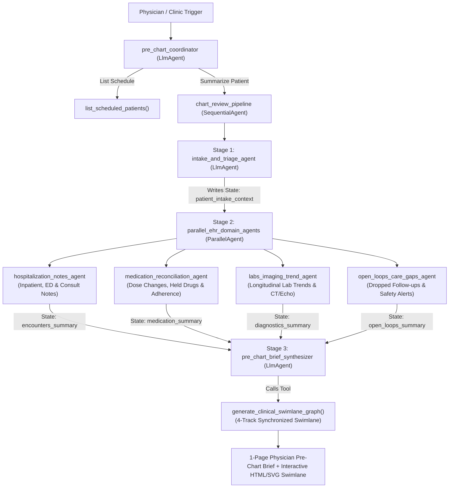

# Agentic Longitudinal EHR Chart Summarizer (Google ADK)

An agentic, multi-agent clinical system built with the **Google Agent Development Kit (`google-adk`)** that reads a patient's longitudinal Electronic Health Record (EHR) history and synthesizes a tailored **1-Page Physician Pre-Chart Brief** before an appointment.

---

## Multi-Agent Architecture

Instead of dumping an entire raw medical record into a single prompt, this project uses a coordinated **Sequential + Parallel Multi-Agent Pipeline**:



---

## Interactive Multi-Track Clinical Swimlane Graph

Each patient's chart synthesis synchronizes **four parallel temporal tracks** along a shared horizontal timeline:
1. **Track 1 · Encounters & Notes**: Inpatient admissions, ED visits, specialist consults, and today's triage.
2. **Track 2 · Medications & Adherence**: Dose changes, held medications, prior authorization blocks, and drug interactions.
3. **Track 3 · Labs, Vitals & Imaging**: Longitudinal biomarker trajectories (`Cr`, `NT-proBNP`, `ALT/AST`, `TSH`, `K+`, `ARR`) and CT/Echo findings.
4. **Track 4 · Open Loops & Safety Alerts**: Triggered safety alerts, unordered follow-up imaging, and today's clinical action triggers.

Generates both inline **Mermaid Gantt + Markdown 4-Track Horizontal Matrices** (for `adk web` and CLI) and self-contained **Interactive HTML/SVG Swimlane Viewers** (`outputs/clinical_swimlane_pat-1001.html`, `pat-1002.html`, `pat-1003.html`) with SVG causal connectors, severity filters, and patient switching.

---

## Dummy EHR Patients Included

| Patient ID | Patient | Chief Complaint Today | Key Hidden Clinical Insights Surfaced by Agents |
| :--- | :--- | :--- | :--- |
| **`PAT-1001`** | **Arthur Pendelton** (68M) | Increasing shortness of breath & ankle swelling | • **Recent ADHF Admission (10/10–10/14):** Discharged on increased Furosemide (40mg) and new Empagliflozin.<br>• **Adherence Gap:** Self-reduced Furosemide to 20mg; never picked up Empagliflozin ($180 Prior Auth block).<br>• **Held Meds Ready to Resume:** Lisinopril & Metformin were held for hospital AKI (Cr 2.3), but outpatient Cr recovered to 1.50 (eGFR 48) — now eligible for Entresto/ACEi & Metformin.<br>• **Dropped Imaging Follow-up:** Incidental 7mm RUL lung nodule on hospital CT needs 6-month follow-up CT ordered. |
| **`PAT-1002`** | **Elena Rostova** (54F) | Persistent fatigue, mild nausea & hand stiffness | • **Drug Hepatotoxicity:** Methotrexate increased from 15mg → 20mg/wk on 10/05; latest ALT/AST jumped to 92/78 U/L (>2.5x ULN).<br>• **Absorption Interaction:** Taking new oral Ferrous Sulfate (started at 9/18 ED visit for NSAID gastritis) at the same time as morning Levothyroxine, causing TSH to spike from 2.4 → 6.8 mIU/L.<br>• **Blocked Biologic Start:** Pre-Humira QuantiFERON-TB Gold resulted *Indeterminate* while on Prednisone taper. |
| **`PAT-1003`** | **Marcus Vance** (42M) | Post-ER follow-up for BP 210/118 & severe headache | • **Critical Drug-Lab Alert:** ED added Chlorthalidone 25mg on 10/31 despite potassium of 3.2 mEq/L; patient now has calf cramps.<br>• **Unreviewed Send-Out Lab:** August 2026 Aldosterone-to-Renin Ratio (ARR = 95) was never reviewed — diagnostic for **Primary Hyperaldosteronism (Conn's Syndrome)**. |

---

## How to Run

### 1. Run via CLI Demo Script
```bash
# Run deterministic agentic pipeline trace (works immediately with or without API key)
.venv/bin/python run_demo.py --patient PAT-1001 --offline

# Try other patients
.venv/bin/python run_demo.py --patient PAT-1002 --offline
.venv/bin/python run_demo.py --patient PAT-1003 --offline

# List all patients on today's schedule
.venv/bin/python run_demo.py --list
```

### 2. Run Live with Gemini LLM (`InMemoryRunner` or `adk web`)
Set your Gemini API key (or Vertex AI environment variables):
```bash
export GOOGLE_API_KEY="your-gemini-api-key"

# Run programmatic ADK runner
.venv/bin/python run_demo.py --patient PAT-1001

# Launch interactive ADK Web UI (with visual Agent Graph & trace inspector)
.venv/bin/adk web
```
In the **ADK Web UI**, select `ehr_chart_summarizer` and try prompts such as:
- *"Who is on my clinic schedule today?"*
- *"Generate a 1-page pre-chart summary for PAT-1001 (Arthur Pendelton)"*
- *"Prepare a pre-chart brief for Elena Rostova (PAT-1002)"*
- *"Summarize Marcus Vance's chart (PAT-1003) before his post-ER visit"*
